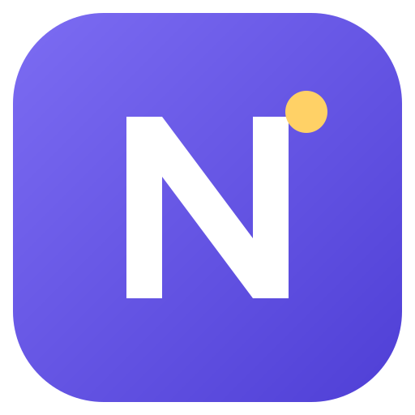
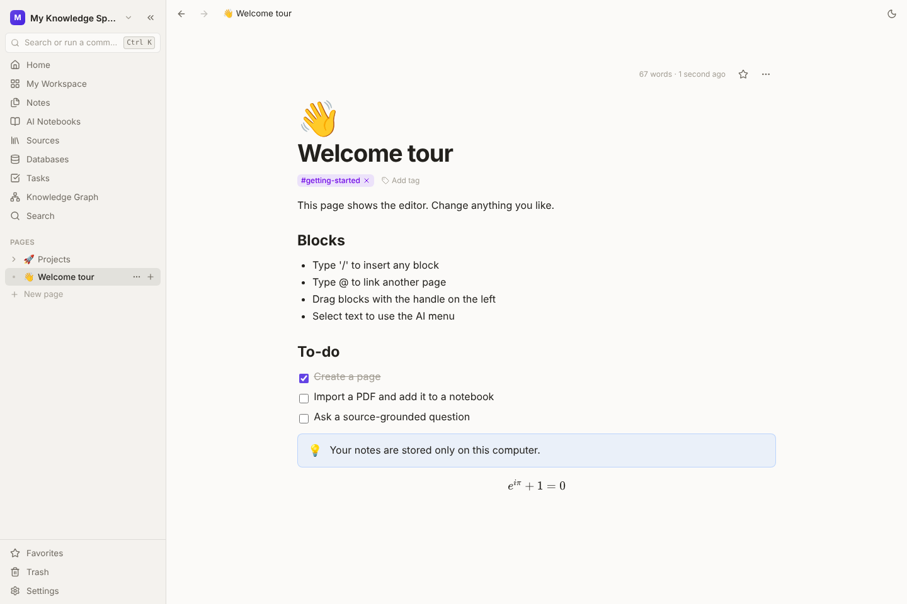
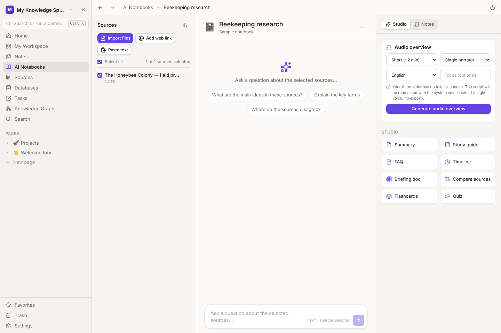
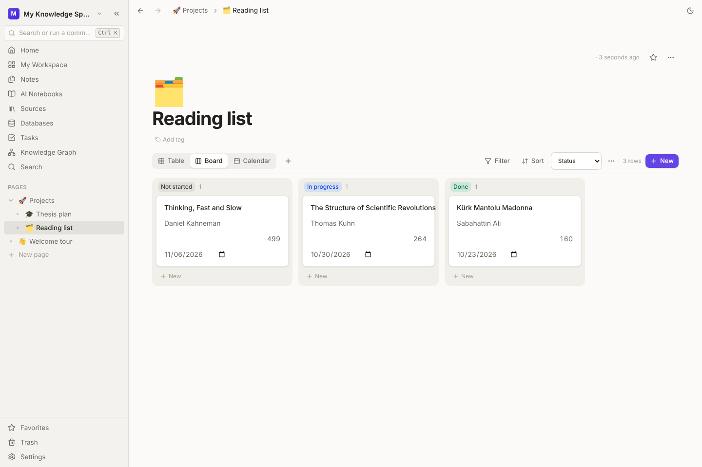
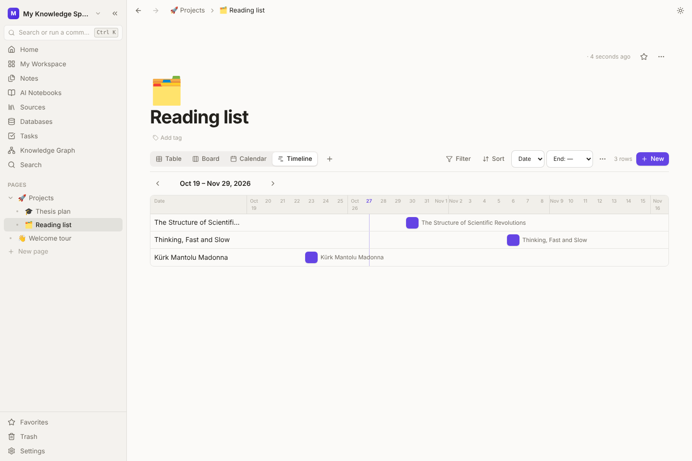
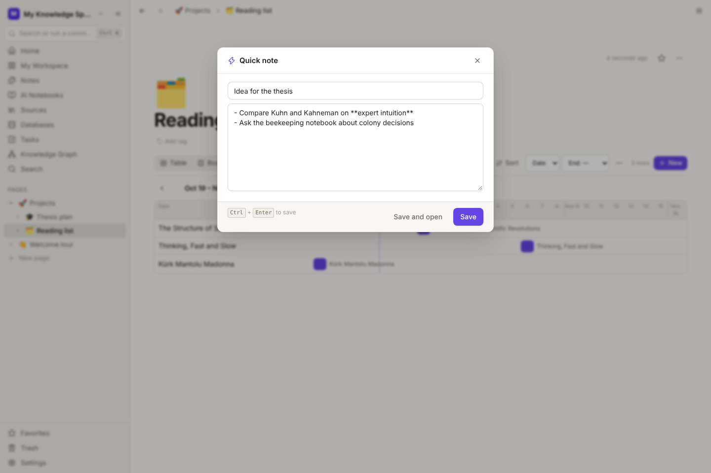
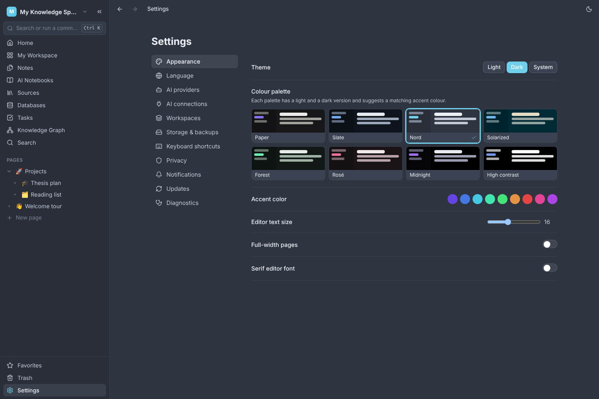
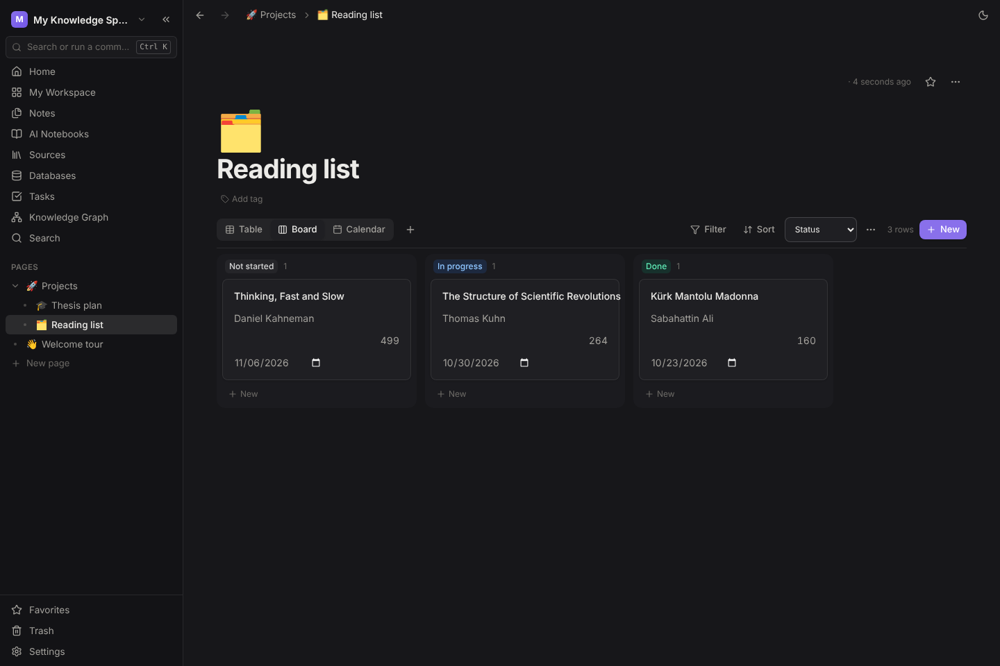

<div align="center">
  
  <h1>Noesis</h1>
  <p><strong>Your notes. Your sources. A clearer picture.</strong></p>
  <p>A local-first desktop workspace for writing, research and connected thinking.</p>
  <p>
    <a href="https://github.com/Bluetwinklez/noesis/releases/latest"></a>
    <a href="https://github.com/Bluetwinklez/noesis/actions/workflows/ci.yml"></a>
    
    
    
  </p>
  <p><a href="https://github.com/Bluetwinklez/noesis/releases/latest"><strong>Download for Windows</strong></a> · <a href="#get-started">Get started</a> · <a href="#connect-your-ai-assistants-mcp">Connect AI assistants</a> · <a href="#türkçe">Türkçe</a> · <a href="docs/implementation-status.md">Project status</a></p>
</div>



Noesis brings block-based notes and source-grounded research into one application. Organize a project, collect its documents, ask questions with navigable citations, and turn the results into notes you can keep editing.

Your workspace lives on your computer. Notes, databases, tasks and local search work without an account, an AI key or an internet connection. Cloud AI is optional and requires your consent.

> **Early preview.** Windows installers are unsigned. AI integrations are covered by mock-provider tests; compatibility with live APIs is not yet verified. See [known limitations](#known-limitations) before relying on this preview for important work.

## What you can do

| Write and organize | Research and understand |
| --- | --- |
| Rich-text blocks, slash commands, Markdown paste and drag handles | Collect PDFs, DOCX, Markdown, text, HTML, CSV and web sources |
| Nested pages, workspaces, tags, favorites and backlinks | Select the sources each notebook should use |
| Tables, code, math, checklists, callouts, images and attachments | Ask questions with streamed answers and source references |
| Autosave, page history, trash and restore | Generate summaries, study guides, flashcards and quizzes |
| Databases with table, board, calendar, timeline, list and gallery views | Preview AI writing changes before applying them |
| Two-way relations, rollups and formulas | Read images and scanned PDFs with offline OCR (English, Turkish) |
| Tasks, recurring reminders, search and a knowledge graph | Create audio overviews with a supported provider |
| Quick capture from anywhere (`Ctrl+Shift+Space`, tray icon) | Clip web pages from Chrome, Edge or Firefox |
| Import Notion exports and Obsidian vaults | Let Claude, Cursor & co. use your notes through MCP |
| Export pages to PDF, Word, Markdown and HTML | Eight colour palettes, each in light and dark |

### A research desk for your own sources



Import documents, review extracted text, then choose which sources a notebook can use. Retrieved passages retain source, page and text-location information. Citation markers are checked against retrieved passages, and clicking a reference opens the relevant source excerpt. A valid reference does not guarantee that the model interpreted it correctly; review the evidence when accuracy matters.

### Structure that fits your work



Track projects and reading lists with typed properties, filters, sorting, grouping and saved views. Link databases with two-way relations and summarise linked rows with rollups (count, sum, average, min/max, percent done). Use recurring tasks and subtasks alongside the notes that give them context.



The **timeline** view places rows on their dates; drag a bar to move it, or drag its right edge to set an end date.

### Capture first, organise later



Press **`Ctrl+Shift+Space`** anywhere in Windows (or use the tray icon) to jot something down. Markdown works, `Ctrl+Enter` saves, and the note lands on your **Inbox** page. From the browser, the **web clipper** extension saves a whole article or just your selection to **Web clips**, with a link back to the source.

Moving in? **Settings → Storage & backups → Import…** reads a Notion export (pages, links, databases from CSV) or an Obsidian vault. Pages export to **PDF**, **Word**, Markdown and HTML.

### Connect your AI assistants (MCP)

Turn on **Settings → AI connections** and click **Connect** next to Claude Desktop, Cursor, Windsurf or LM Studio; Noesis writes their configuration for you (with a backup) and starts automatically when they need it. For Claude Code, copy the one-line command shown there.

Assistants can search notes and sources, read pages, and create pages and tasks. Changing an existing page always needs your approval in a dialog. The endpoint listens only on `127.0.0.1`, requires a key and refuses web pages.

### Always up to date

Installed copies check for updates in the background and install them when you close the app (or right away from the banner). Every change merged to `main` produces a signed build. You can turn this off in **Settings → Updates**.

### Make it yours



Eight colour palettes (Paper, Slate, Nord, Solarized, Forest, Rosé, Midnight, High contrast), each with a light and a dark version, plus accent colours, editor font and width.

<details>
  <summary><strong>See dark mode</strong></summary>



</details>

*Screenshots show the real application in browser-preview mode with its built-in sample workspace. The Windows application uses the same interface in a native Tauri shell.*

## Download and install

1. Open the [latest release](https://github.com/Bluetwinklez/noesis/releases/latest).
2. Download **`Noesis_<version>_x64-setup.exe`** for a normal per-user installation. MSI packages (English and Turkish) are also provided for managed deployment. The **`noesis-web-clipper.zip`** asset is the browser extension ([install steps](extensions/web-clipper/README.md)).
3. Optionally compare the file's SHA-256 hash with `SHA256SUMS.txt` from the same release:

   ```powershell
   Get-FileHash .\Noesis_<version>_x64-setup.exe -Algorithm SHA256
   ```

4. Run the installer and complete onboarding. You can skip AI setup and start with sample content.

**Requirements:** Windows 10 or 11, x64. The installer can download Microsoft WebView2 if it is missing. Installers are **not code-signed** (no Windows publisher certificate) and may trigger SmartScreen warnings or be blocked by device policy. Updates *are* signed with the project's update key and verified before installing.

**Updates:** from v0.1.3 on, Noesis updates itself. It checks shortly after start and every few hours, downloads in the background and installs when you close it (or immediately from the banner). Coming from **v0.1.0**? That version has no updater: install the latest release once over it; your workspace is kept.

Uninstall through **Settings → Apps → Installed apps → Noesis**. Workspace data is kept in `%APPDATA%\app.noesis.desktop`. Export a backup before changing your installation.

## Get started

1. **Make a workspace.** Choose a theme and create your first page. Sample content is optional.
2. **Capture an idea.** Use `/` to insert a block and `@` to mention another page.
3. **Bring in sources.** Open Sources, import documents, and check the extraction status.
4. **Open a research notebook.** Select its sources. To ask AI questions, configure a provider in Settings.
5. **Keep the useful parts.** Review citations and save generated material as editable notes.
6. **Back up your work.** Use Settings → Storage & backups to export a `.noesisbak` archive.

### AI, on your terms

Noesis includes adapters for OpenAI, Gemini, Anthropic, Ollama and OpenAI-compatible servers. Capabilities vary by provider and model. API usage may carry provider charges.

- **Cloud:** the application requests permission before sending content. Desktop API keys use Windows Credential Manager.
- **Local:** use an Ollama or compatible server on your computer. Offline semantic search also has a lightweight local-vector fallback.
- **Try without a key:** run `node scripts/mock-ai-server.mjs 11435`, choose an OpenAI-compatible server at `http://127.0.0.1:11435/v1`, and enter `test-key`. This produces deterministic test responses, not real AI reasoning.

See [AI configuration](docs/ai-configuration.md) and [privacy & security](docs/security/privacy-security.md).

### Keyboard shortcuts

| Shortcut | Action |
| --- | --- |
| `Ctrl+K` | Search or run a command |
| `Ctrl+Shift+Space` | Quick note (system-wide in the desktop app) |
| `Ctrl+Alt+N` | Create a page |
| `Ctrl+Shift+F` | Open search |
| `Ctrl+,` | Open settings |
| `Ctrl+\` | Toggle the sidebar |
| `Ctrl+Shift+L` | Toggle light/dark appearance |
| `Alt+←` / `Alt+→` | Navigate back/forward |

## Run from source

Install **Node.js 24**, Rust stable, and the [Tauri platform prerequisites](https://v2.tauri.app/start/prerequisites/). Windows builds need the Visual Studio C++ Build Tools and WebView2.

```bash
git clone https://github.com/Bluetwinklez/noesis.git
cd noesis
npm ci
npm run dev          # Browser preview: http://localhost:1420
npx tauri dev        # Native desktop application
```

The browser preview uses SQLite WASM and IndexedDB. It is intended for development; its API-key storage does not provide the protection of Windows Credential Manager. Use test keys in the preview.

```bash
npm run typecheck    # TypeScript checks
npm test            # Unit and integration tests
npm run e2e         # Browser workflows (Edge by default)
npm run build       # Production frontend
cd src-tauri
cargo test --locked # Native backend tests; build the frontend first
cd ..
npx tauri build     # Windows NSIS and MSI installers
```

For Chromium instead of Edge, run `npx playwright install chromium` and set `PW_CHANNEL=chromium`. [Testing documentation](docs/testing/README.md) explains each check. `npm run screenshots` regenerates the README images from sample data.

## Reliability and release checks

The release workflow checks TypeScript, unit/integration tests, browser workflows and production dependencies. A Windows runner then executes Rust tests, builds NSIS/MSI installers, installs the NSIS package, launches the app, checks database creation and uninstalls it. Published assets include SHA-256 checksums.

Backup creation uses a consistent database snapshot and refuses to silently omit missing attachments. Restore validates manifest versions, table counts and attachment checksums before replacing data. Cancelling the safety-backup dialog also cancels the restore.

These checks are useful evidence, not a claim that every device or live AI provider has been tested. The [implementation status](docs/implementation-status.md) keeps that distinction explicit.

## Known limitations

- Preview software; installers are not code-signed (needs a purchased certificate).
- Live AI provider compatibility, transcription and speech quality still need real-provider verification. OCR runs offline (Tesseract); accuracy on poor scans is limited.
- No cloud sync, database encryption at rest or YouTube transcript import.
- Local hashed vectors are a fallback, not a replacement for a trained embedding model (use Ollama or a cloud provider for real semantic search).
- Direct PDF export embeds Roboto: emoji and CJK characters are dropped (use **Print…** for those).
- The web clipper is installed in developer mode; it is not in the Chrome/Firefox stores yet.
- Notifications require the app to be running. Very large graphs and source collections need further performance testing.
- Database IPC still accepts SQL strings (guarded by an SQLite authorizer); see [security notes](docs/security/privacy-security.md).
- English and Turkish interfaces are available. Repository documentation is maintained in English, with a short [Turkish summary](#türkçe).

## Roadmap

- [x] Offline OCR, signed auto-updates, SSRF-safe fetching and a guarded SQL bridge.
- [x] Direct PDF/DOCX export, timeline view, two-way relations and rollups, Notion/Obsidian import.
- [x] Web clipper, quick capture, MCP connection for AI assistants, colour palettes.
- [ ] Verify live provider chat, embeddings, transcription and audio.
- [ ] Add a trained local embedding model.
- [ ] Code signing certificate; publish the clipper to browser stores.
- [ ] Replace the SQL bridge with typed native commands; optional database encryption.
- [ ] User-controlled synchronization; improve large-graph performance with recorded benchmarks.

## Documentation and contributing

[Architecture](docs/architecture/README.md) · [Database schema](docs/architecture/database-schema.md) · [AI setup](docs/ai-configuration.md) · [Security](docs/security/privacy-security.md) · [Testing](docs/testing/README.md) · [Benchmarks](docs/testing/benchmarks.md) · [Research](docs/research/README.md) · [Releasing](docs/releases/README.md) · [Web clipper](extensions/web-clipper/README.md) · [All releases](https://github.com/Bluetwinklez/noesis/releases)

Found a bug? [Open an issue](https://github.com/Bluetwinklez/noesis/issues/new) with reproduction steps, your OS, app version and relevant redacted diagnostics. Never include API keys or private source documents. For code contributions, start with [CONTRIBUTING.md](CONTRIBUTING.md).

Noesis is an independent implementation inspired by publicly documented workspace and research concepts. It is not affiliated with Notion or Google NotebookLM and includes no proprietary code, branding or private APIs from either product.

## Türkçe

Noesis; notlarınızı, veritabanlarınızı ve kaynak belgelerinizi tek bir yerde toplayan, **bilgisayarınızda çalışan** bir masaüstü uygulamasıdır. Hesap, internet veya yapay zekâ anahtarı olmadan çalışır; bulut yapay zekâ isteğe bağlıdır ve her zaman onayınızı ister. Arayüz Türkçe ve İngilizce'dir.

- **İndir:** [son sürüm](https://github.com/Bluetwinklez/noesis/releases/latest) → `Noesis_<sürüm>_x64-setup.exe`. Windows “bilinmeyen yayıncı” uyarısı verirse *Ek bilgi → Yine de çalıştır* deyin (kod imzalama sertifikası henüz yok).
- **Güncelleme:** v0.1.3'ten itibaren uygulama kendini günceller; uygulamayı kapattığınızda kurulur. v0.1.0 kullanıyorsanız son sürümü bir kez elle üzerine kurun, verileriniz korunur.
- **Neler var:** bloklu editör, iç içe sayfalar, veritabanları (tablo, pano, takvim, zaman çizelgesi; iki yönlü ilişki ve toplama), görevler, bilgi grafiği, kaynaklara dayalı yapay zekâ defterleri, çevrimdışı OCR (Türkçe dahil), PDF/Word dışa aktarma, Notion/Obsidian içe aktarma, 8 renk paleti.
- **Hızlı not:** Windows'un herhangi bir yerinde `Ctrl+Shift+Space`. **Web kırpıcı** eklentisi ile tarayıcıdan sayfa kaydedin.
- **Yapay zekâ asistanları:** *Ayarlar → AI bağlantıları* bölümünden Claude Desktop, Cursor, Windsurf veya LM Studio'ya tek tıkla bağlayın; mevcut bir sayfanın değiştirilmesi her zaman onayınızı gerektirir.
- Hata bildirmek için [issue açın](https://github.com/Bluetwinklez/noesis/issues/new); API anahtarı veya özel belge paylaşmayın.
